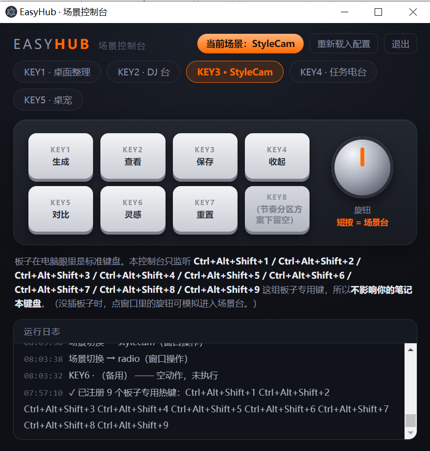
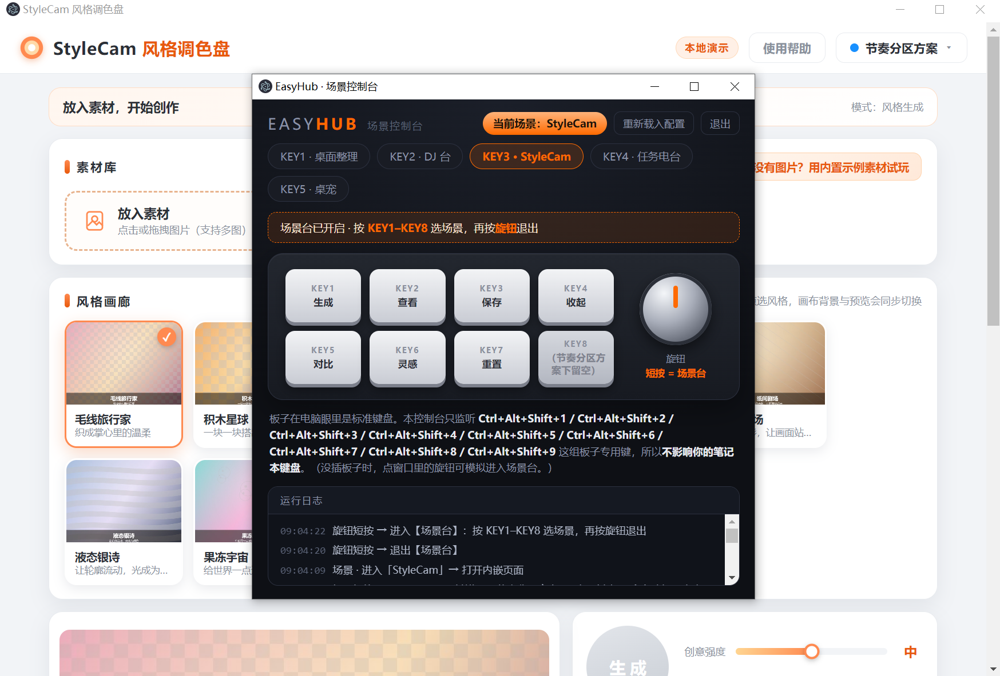
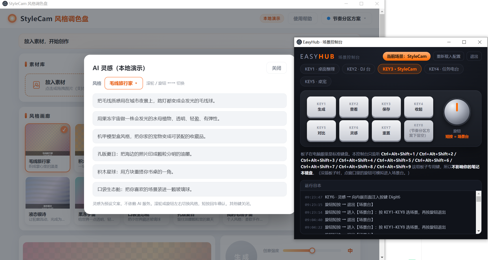
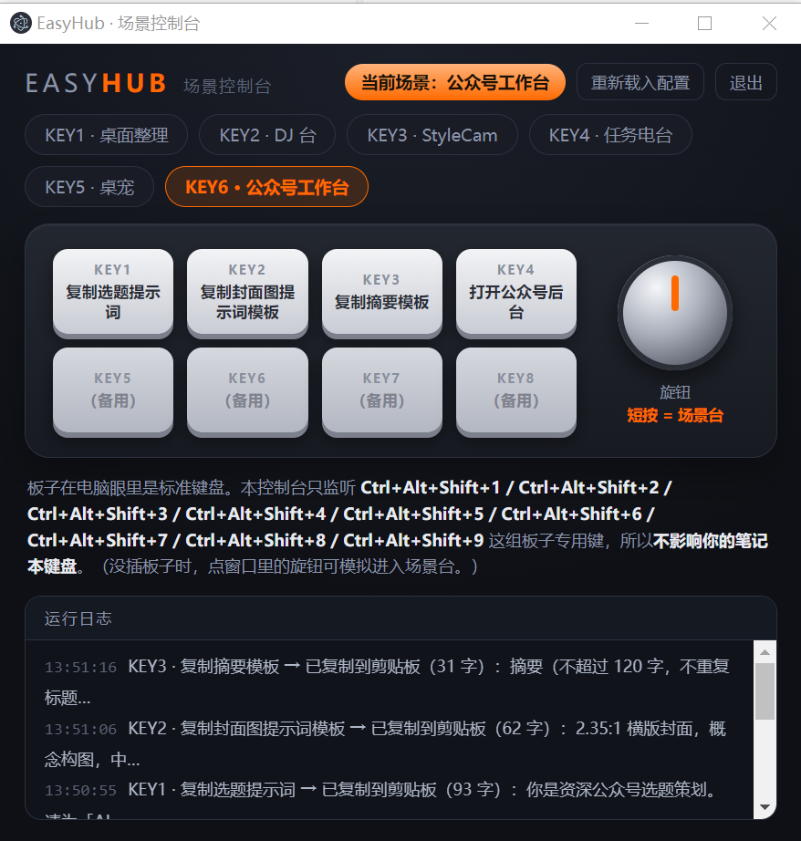

# EasyHub · EasyInput 场景化快捷键控制台

> 第八课毕业大作业 · 软硬件协同
> 给 EasyInput 开发板的 8 个实体键 + 旋钮加一层「场景」：**同一排键在不同场景下含义不同**。
> 全程**不烧录固件**，只在官方上位机改键 + 软件层做映射。

---

## 它做什么

板子在电脑眼里就是一块标准 USB 键盘。本项目的做法是把"这块键盘"变成一套**可切换的工作台**：

- **硬件层固定** —— 用官方上位机把 8 个键改成 `Ctrl+Alt+Shift+1..8`、旋钮短按改成 `Ctrl+Alt+Shift+9`。板子固件一个字节都没改。
- **软件层换表** —— 程序全局独占注册这 9 个热键，当前「场景」决定这排键此刻是什么。
- **场景台** —— 旋钮短按呼出场景台，此时 `KEY1–KEY8` 直接选场景（不做两级菜单，不靠盲记）。

```
        ┌──────────── 硬件层（固定）────────────┐
  KEY1..KEY8 ──► Ctrl+Alt+Shift+1..8            │  板子出厂固件，未改动
  旋钮短按   ──► Ctrl+Alt+Shift+9               │
        └────────────────┬─────────────────────┘
                         │  USB HID
        ┌────────────────▼─────────────────────┐
        │  软件层（可换）  config/scenes.json   │  同一排键 → 当前场景的动作
        │  桌面整理 / DJ 台 / StyleCam / ...    │  换表不换逻辑
        └──────────────────────────────────────┘
```

## 真机实测（2026-10-11）

| 截图 | 证明了什么 |
|-|-|
|  | 控制台界面与运行日志：同排 8 键在 StyleCam 场景下映射为「生成 / 查看 / 保存 / 收起 / 对比 / 灵感 / 重置 / 留空」；日志确认「已注册 9 个板子专用热键」 |
|  | 旋钮短按**真机触发**场景台（日志行无「窗口操作」后缀，只可能来自板子发来的热键）；切场景自动打开内嵌页并切到「节奏分区方案」 |
|  | 端到端闭环：按下实体键 `KEY6` → 日志「KEY6 · 灵感 → 向内嵌页面注入按键 Digit6」→ 网页弹出「AI 灵感」面板 |
|  | **剪贴板兜底**实测：切到第 6 个场景「公众号工作台」后，实体键 `KEY1`/`KEY2`/`KEY3` 依次触发「已复制到剪贴板（93 / 62 / 31 字）」—— 目标软件没有可驱动通道，按键先把文案备好，切过去 `Ctrl+V` 即可 |

实测键码：`KEY1` = `ControlLeft` → `ShiftLeft` → `AltLeft` → `Digit1`。

---

## 快速开始

### 0. 你需要什么

- **EasyInput V2 开发板**（ESP32-S3，8 键 + 旋钮）—— 或任一能发出自定义组合键的键盘
- 官方上位机（用于改键）
- Node.js + Electron

### 1. 板子改键（一次性）

用官方上位机把 8 个键依次配成 `Ctrl+Alt+Shift+1` … `Ctrl+Alt+Shift+8`，旋钮短按配成 `Ctrl+Alt+Shift+9`，点「同步到键盘」。

> 录入小技巧：四个键**几乎同时按下、按住不松再一起松开**，录入框才能完整捕获。

### 2. 装依赖并启动

```bash
cd easyhub
npm install --save-dev electron
npm start
```

Windows 下也可以双击 `easyhub/启动EasyHub.cmd`，但**必须先把脚本里的 `ELECTRON` 路径改成你自己电脑上 `electron.exe` 的位置**。

### 3. 操作

- 直接按 `KEY1–KEY8` → 执行当前场景下这排键的动作
- **旋钮短按** → 进入【场景台】，此时 `KEY1–KEY8` 选场景，再按一次旋钮退出
- 关掉控制台窗口 = 退出程序（全局热键一并注销）

---

## 接入你自己的场景（这才是可复用的部分）

`easyhub/config/` 下是两张**纯数据表**，`main.js` 里没有一行硬编码的场景逻辑 —— **换表不换逻辑**。

**`config/keys.json`** —— 物理键 → 板子实际发出的键（用别的组合键时回填这里）

```json
{ "keys": { "KEY1": "Ctrl+Alt+Shift+1", "KEY2": "Ctrl+Alt+Shift+2", "KNOB": "Ctrl+Alt+Shift+9" } }
```

**`config/scenes.json`** —— 场景 → 每个键干什么

```json
{
  "active": "desktop",
  "scenes": [
    {
      "id": "desktop",
      "name": "桌面整理",
      "desc": "用实体键操作桌面文件",
      "keys": {
        "KEY1": { "label": "打开整理工具",
                  "action": { "type": "run", "target": "C:/tools/一键桌面整理.exe", "args": [] } }
      }
    }
  ]
}
```

动作类型：

| `type` | 字段 | 作用 |
|-|-|-|
| `run` | `target`、`args` | 启动一个程序（后台分离运行） |
| `open` | `target` | 用系统默认方式打开文件 / 目录 |
| `url` | `target` | 用默认浏览器打开链接 |
| `keys` | `code` | 向本场景的**内嵌页面**注入一个按键事件（见下） |
| `clipboard` | `text` | **无输入框兜底**：把 `text` 写进系统剪贴板，切到目标软件 `Ctrl+V` 即可 |

> `clipboard` 解决的是"目标软件没有输入框、也没有可驱动通道"的情况 —— 不硬把内容塞进去，改成按键先备好内容，人再粘贴。`config/scenes.json` 的 `wechat`（公众号工作台）场景就是这个用法的示范：KEY1–KEY3 分别把选题提示词 / 封面图提示词模板 / 摘要模板送进剪贴板。

场景可选字段：

- `embed` —— 切到本场景时自动打开这个网页（放进内嵌窗口 `BrowserWindow`）
- `setupJS` —— 内嵌页面加载完成后执行的 JS，用来把页面切到指定状态

### `keys` 注入是怎么做的（以及为什么这么做）

浏览器**会忽略系统级合成按键** —— 实测用 PowerShell 的 `SendKeys` 打进去的输入，页面收不到任何反应（EasyHub 日志显示"已发送"，网页却毫无动静）。

所以改成：把目标页面放进 Electron 的内嵌窗口，再用 `webContents.executeJavaScript` 在页面里派发一个合成 `KeyboardEvent`：

```js
document.dispatchEvent(new KeyboardEvent('keydown', { code: 'Digit6', bubbles: true, cancelable: true }))
```

好处是**不依赖窗口焦点**，也不受操作系统输入层干扰，`code` 完全可控。

对目标页面只有一个要求：**把 `keydown` 监听挂在 `document` 上，并且读 `e.code`**（不是 `e.key`）。

最小示例 —— 接入你自己的网页：

```json
{
  "id": "my-page",
  "name": "我的网页",
  "embed": "C:/path/to/your/page.html",
  "keys": {
    "KEY1": { "label": "触发 A", "action": { "type": "keys", "code": "Digit1" } },
    "KEY2": { "label": "触发 B", "action": { "type": "keys", "code": "Digit2" } }
  }
}
```

---

## 仓库自带的两套网页场景

### `demo/stylecam` —— 可被完整驱动

StyleCam 风格调色盘（纯前端单页）。它自带两套键位方案，本项目默认切到作者习惯的「**节奏分区方案**」（由 `setupJS` 自动切换）：`KEY1–KEY7` → `Digit1–Digit7`，`KEY8` 留空。

配置片段见 `easyhub/config/scenes.json` 的 `stylecam` 场景。

### `demo/dj-console` —— 启动型示范

EasyInput DJ 控制台（3D 键帽皮肤，单文件 HTML）。它只有鼠标交互、没有键盘映射，因此只作为"按一下键把它打开"的**启动型场景**示范。

---

## 目录结构

```
easyhub/
├─ main.js              主进程：全局热键注册 + 场景派发 + 内嵌页面注入
├─ preload.js
├─ renderer/            控制台界面（当前场景 / 键位可视化 / 运行日志）
├─ config/
│   ├─ keys.json        物理键 → 实际键码（事实源）
│   └─ scenes.json      场景表（纯数据）
├─ tools/selfcheck.js   配置自检（路径是否存在、热键数量、JSON 合法性）
├─ demo-desktop/        桌面整理场景的演示目录
└─ 启动EasyHub.cmd      Windows 启动脚本（需改 ELECTRON 路径）
demo/                   两套自带的网页场景
docs/evidence/          真机实测截图
```

---

## 已知限制（如实说明）

1. **需要硬件才能完整体验**。没有板子也能验证软件层：把 `config/keys.json` 里的组合键换成键盘上真实存在的组合键（例如 `Ctrl+Alt+1`），行为完全一致。
2. **`启动EasyHub.cmd` 里的 electron 路径是作者本机的**，直接双击之前请改掉；用 `npm start` 则不受影响。
3. **`config/scenes.json` 里另有三个场景**（桌面整理 / 任务电台 / 桌宠）指向作者本机的 `.exe`，这些程序**不在本仓库内**，仅作配置示例。把 `target` 换成你自己的程序路径即可接入。
4. **注入方案有前提**：目标页面必须把 `keydown` 监听在 `document` 上并读 `e.code`；不满足的页面只能当"启动型场景"。
5. 日志时间戳只有时 / 分 / 秒，不带日期。

---

## 硬件与背景

- 板子：EasyInput V2（ESP32-S3），2×4 键阵 + 旋钮，出厂即标准 USB 键盘（USB HID）
- **全程不改固件**：只在上位机改键 + 软件层映射，硬件一个字节未动
- 运行栈：Electron（`globalShortcut` / `BrowserWindow` / `webContents.executeJavaScript`）
- 完整的方案论证、选型过程与逐键实测记录见随作业提交的过程文档

## License

MIT（见 `easyhub/package.json`）
